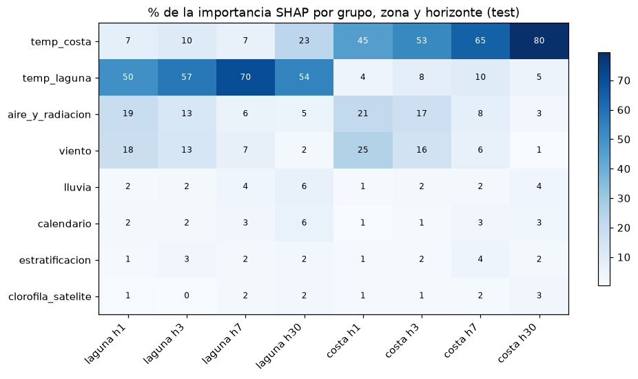
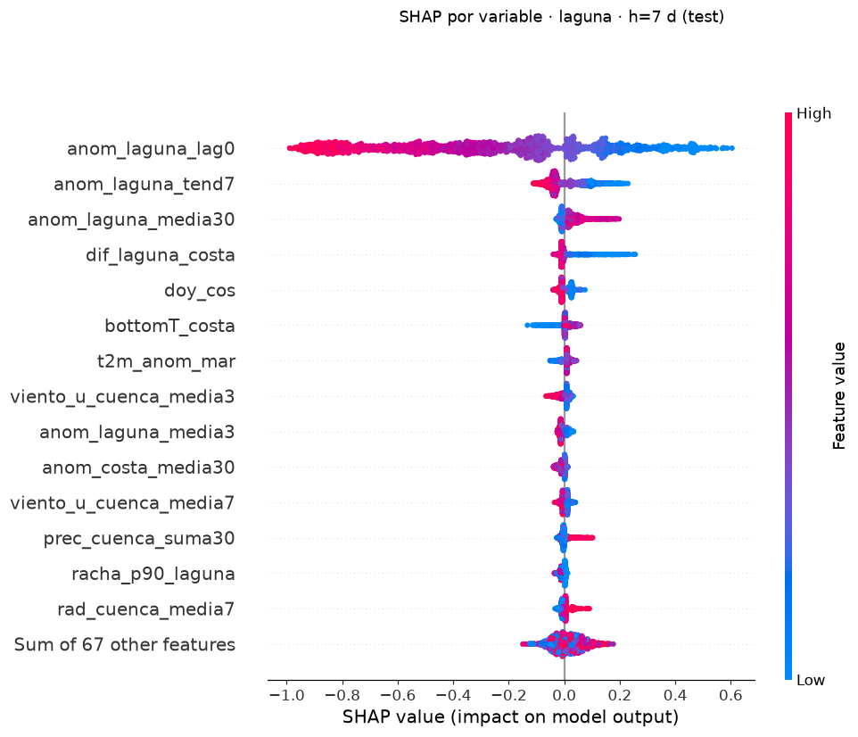
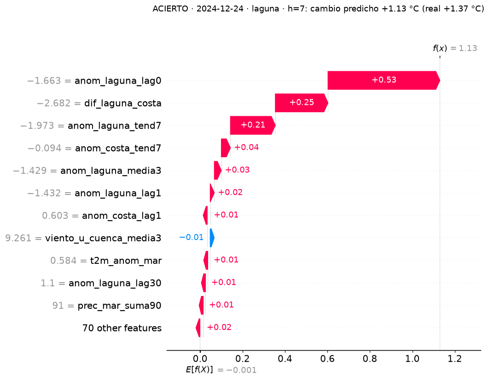
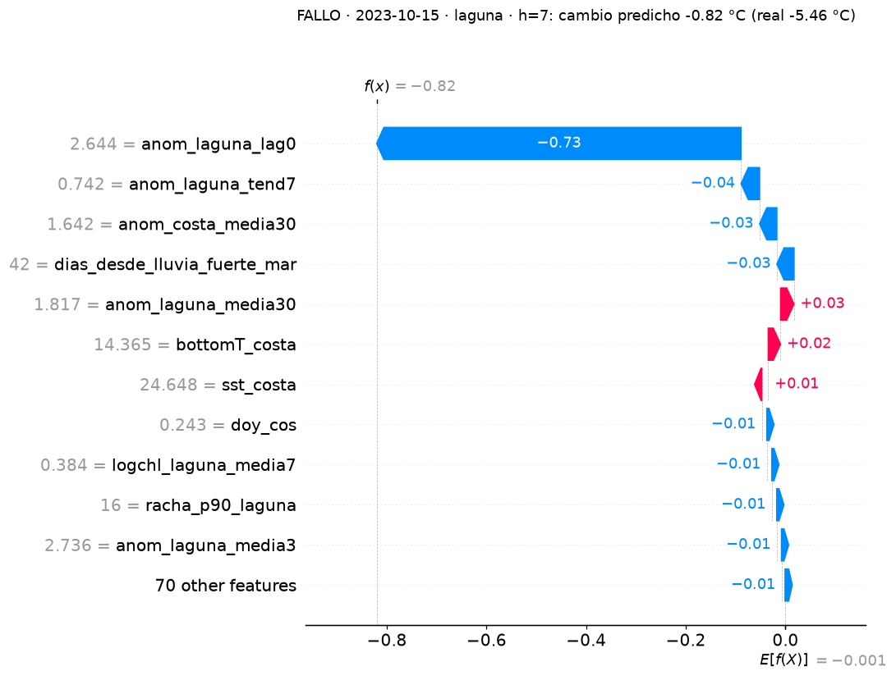
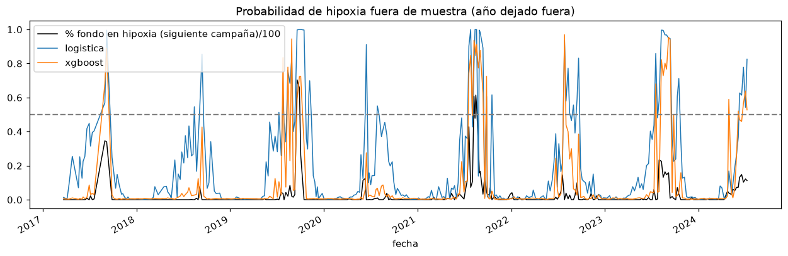
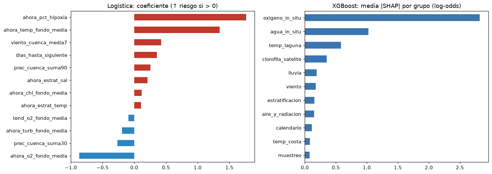

# Fase 3 — Primer modelo + XAI

*2026-11-09 · Reproducible con `python scripts/entrenar_sst.py` y `python scripts/entrenar_hipoxia.py`.
Experimentos en MLflow (`mlflow ui --backend-store-uri sqlite:///mlflow.db`): `sst_mar_menor` y `hipoxia_mar_menor`.*

## 1. Temperatura del mar (SST) a 1, 3, 7 y 30 días

**Montaje**
- XGBoost que predice el **cambio de anomalía** (`y_delta`). Un modelo por zona y horizonte (8 en total).
- Hiperparámetros elegidos con **validación de origen móvil**: 4 cortes de 2 años entre 2011 y 2018.
- Modelo entrenado en train, evaluado en validación (2019–21), reentrenado con train + validación y evaluado **una sola vez** en test (2022–sep 2026).
- Purga de frontera en todas las particiones.

**Error en test (RMSE, °C)**

| Zona | h | Modelo | Persistencia | Pers. amortiguada | Climatología | Mejora vs. mejor línea base | Cobertura del intervalo del 90 % |
|---|---|---|---|---|---|---|---|
| Laguna | 1 | **0,456** | 0,476 | 0,483 | 1,880 | +4,2 % | 89 % |
| Laguna | 3 | **0,740** | 0,792 | 0,811 | 1,881 | +6,6 % | 87 % |
| Laguna | 7 | **0,944** | 0,989 | 1,029 | 1,883 | +4,6 % | 84 % |
| Laguna | 30 | **1,291** | 1,443 | 1,459 | 1,893 | +10,5 % | 82 % |
| Costa | 1 | **0,341** | 0,357 | 0,366 | 1,615 | +4,5 % | 87 % |
| Costa | 3 | **0,557** | 0,559 | 0,581 | 1,616 | +0,4 % | 82 % |
| Costa | 7 | 0,775 | **0,765** | 0,805 | 1,618 | **−1,3 %** | 81 % |
| Costa | 30 | **1,205** | 1,305 | 1,296 | 1,628 | +7,7 % | 78 % |

**Lectura honesta**
- **Laguna:** el modelo bate a las tres líneas base en todos los horizontes (+4 % a +10 %).
- **Costa:** a 3–7 días el modelo **empata con la persistencia simple**.
- Frente a la línea base acordada (persistencia amortiguada), el modelo gana en los 8 casos.
- En test, la **persistencia simple supera a la amortiguada**. El motivo es la deriva: con el mar más cálido, las anomalías ya no se "apagan" hacia la climatología de 1982–2018. Lo mismo explica que la climatología falle tanto (1,6–1,9 °C).
- **Intervalos:** el intervalo del 90 %, calibrado con los errores de validación, cubre en test entre el 78 % y el 89 %. Se queda corto a horizontes largos por la misma deriva. Para la API (Fase 4) conviene recalibrarlo con errores recientes (conformal con ventana móvil).

**Olas de calor derivadas** (SST predicha > p90; F1 en test; entre paréntesis, la persistencia amortiguada)

| h | Laguna | Costa |
|---|---|---|
| 1 | 0,86 (0,87) | 0,86 (0,86) |
| 3 | **0,78** (0,73) | 0,78 (0,78) |
| 7 | **0,60** (0,51) | **0,60** (0,56) |
| 30 | **0,37** (0,08) | **0,30** (0,06) |

A 1–3 días cualquier método acierta, porque una ola de calor en curso tiende a seguir. El valor del modelo aparece a **7 y 30 días**. A 30 días, la persistencia amortiguada casi nunca predice olas de calor porque "apaga" la anomalía.

## 2. Qué ha aprendido el modelo (SHAP)

- **La temperatura propia domina** (50–80 % de la importancia). Como el objetivo es el *cambio*, esto refleja la **reversión a la media**: una anomalía alta hoy empuja a enfriarse (SHAP negativo) y una anomalía fría, a recuperarse.
- **Corto plazo (1–3 días): la meteorología pesa un 30–45 %** (aire, radiación y viento). Es física: a pocos días, lo que calienta o enfría el agua es la atmósfera.
- **Largo plazo (30 días): la laguna "mira" a la costa** (23 % de la importancia). La laguna somera intercambia agua con el mar abierto y su anomalía acaba convergiendo hacia la de la costa.
- La clorofila de satélite y la capa de mezcla apenas aportan a la SST.

Lectura de las variables principales (laguna, h = 7):
- `anom_laguna_lag0`: alta → enfriamiento (reversión).
- `anom_laguna_tend7`: si se ha calentado rápido, tiende a corregir.
- `anom_laguna_media30`: una anomalía **sostenida** un mes se mantiene. Es la "memoria" de las olas de calor.
- `dif_laguna_costa`: si la laguna está más fría que la costa, se calienta hacia ella.

**Dos días explicados** (laguna, h = 7):

| Acierto | Fallo |
|---|---|
|  |  |

- **Acierto (24-12-2024):** la laguna estaba 1,7 °C por debajo de lo normal y 2,7 °C más fría que la costa. El modelo predijo un rebote de +1,1 °C (real: +1,4 °C) apoyándose en la reversión a la media y en la diferencia con la costa. Es la física esperable de una laguna somera.
- **Fallo (15-10-2023):** la laguna llevaba **16 días en ola de calor** (+2,6 °C). El modelo predijo un enfriamiento moderado (−0,8 °C), pero la semana siguiente cayó **5,5 °C**. ERA5 muestra el motivo: un **temporal de viento entre el 18 y el 20 de octubre** (rachas de hasta 59 km/h en el mar), *posterior* al día de la predicción, que mezcló el agua y terminó con la ola de calor (24,1 → 18,5 °C en 4 días). El día 15 no había ninguna señal de ese temporal en los datos pasados: el modelo no podía saberlo.

**Para qué sirve esto:** los finales bruscos de las olas de calor los deciden temporales que todavía no han ocurrido. Es el argumento para la mejora de la Fase 5/7 de **añadir previsión meteorológica** (viento y temperatura del aire previstos) como entrada.

## 3. Riesgo de hipoxia en la próxima campaña

**Montaje:** validación dejando un año fuera (2017–2024), sin búsqueda de hiperparámetros por la escasez de datos.

| Modelo | Recall | Precisión | Falsas alarmas | Episodios detectados | **Inicios anticipados** | PR-AUC |
|---|---|---|---|---|---|---|
| Persistencia | 0,73 | **0,76** | **7** | 7/9 | 1/9 | — |
| Logística (12 variables) | **0,80** | 0,46 | 28 | 7/9 | **4/9** | **0,65** |
| XGBoost (prof. 2) | 0,70 | 0,66 | 11 | 6/9 | 2/9 | 0,58 |

**Lectura**
- **Ningún modelo es mejor en todo.** La persistencia es la más precisa, pero solo detecta un episodio que ya ha empezado. La **logística anticipa 4 de los 9 inicios** (2017, 2019, 2023 y 2024), a costa de unas 4 falsas alarmas por cada acierto.
- XGBoost no supera a la persistencia: con 30 positivos y 60 variables no hay datos suficientes para un modelo flexible. Hoy, el modelo sencillo es la elección correcta.
- **Propuesta para el gemelo:** usar la logística como **alerta temprana** ("riesgo elevado") y la persistencia como **confirmación**.

- El riesgo sube con la **hipoxia actual**, la **temperatura del fondo** y un **oxígeno de fondo bajo**. Todo es coherente con la física: el agua caliente disuelve menos oxígeno y la degradación de materia orgánica lo consume.
- **Cuidado con la causalidad:** el viento sale con coeficiente positivo, cuando físicamente el viento mezcla y oxigena. Lo más probable es que sea una correlación estacional (brisas de verano), no un efecto real. SHAP y los coeficientes explican **lo que usa el modelo**, no cómo funciona la laguna.

## 4. Conclusiones y próximos pasos
1. **Entregable cumplido:**
   - SST: el modelo bate a la línea base acordada en los 8 casos y a la mejor línea base en 7 de 8.
   - Olas de calor: mejora clara a 7 y 30 días.
   - Hipoxia: anticipa inicios que la persistencia no puede anticipar.
2. **La deriva es el problema principal**: afecta a las líneas base y a la cobertura de los intervalos. Habrá que monitorizarla y reentrenar o recalcular la climatología (Fase 7).
3. Para la Fase 4 (API) se registrarán en el Model Registry los modelos **SST laguna/costa** y la **logística de hipoxia**, con el intervalo conformal y los SHAP por grupo en `/explain`.
