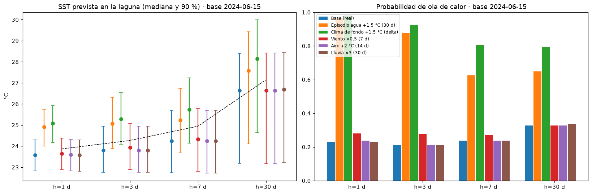

# Fase 5 — Motor de escenarios

*2026-11-09 · `POST /scenario` y `GET /scenario/drivers` · ejemplos: `python scripts/escenarios_ejemplo.py`*

## Cómo funciona

1. **Se perturba la serie de origen, no las variables.** El escenario modifica la serie diaria (agua, aire, lluvia, viento, radiación, clorofila) durante los últimos `dias`. Después recalcula **todas** las variables (lags, medias, rachas, días desde la última lluvia…) con el mismo código del pipeline, sobre un tramo de 400 días. Un test garantiza que, sin perturbación, se obtiene exactamente lo mismo que `/predict` (diferencia < 10⁻¹³).
2. **Dos tipos de calentamiento del agua**, conceptualmente distintos:
   - `temp_agua`: un **episodio** cálido reciente. El modelo lo ve como una anomalía y predice que revierte en parte.
   - `calentamiento_base`: un **cambio del clima de fondo** (método delta). Se desplaza la climatología. Las variables del modelo no cambian (no se le pide extrapolar) y la SST sube exactamente +x, mientras el umbral de ola de calor se mantiene en la base estándar 1991–2020.
3. **Incertidumbre (Monte Carlo):**
   - Cada perturbación admite `incertidumbre` (desviación típica), que se muestrea con un **hipercubo latino** (30 muestras por defecto).
   - Cada muestra se combina con los ~365 **errores recientes** del modelo, los mismos del intervalo de `/predict`.
   - La **diferencia** entre escenario y base es emparejada (el mismo error en ambos): solo refleja la respuesta del modelo y la incertidumbre de la perturbación.
4. **Aviso fuera de rango:** cada variable del escenario se compara con el rango visto en entrenamiento, y se devuelve la fracción de muestras que se salen. También se avisa si la SST prevista supera el máximo observado desde 1982.
5. **Explicación del cambio:** diferencia de SHAP (escenario − base) por grupo para la SST y diferencia de contribuciones (log-odds) para la hipoxia.
6. **Lo que no se puede simular:** nitratos, fosfatos y vertidos. No son entradas de los modelos (`GET /scenario/drivers` → `no_disponibles`). La API lo dice en lugar de inventarlo.

## Escenarios de ejemplo — laguna, base 15-06-2024 (campaña de hipoxia 10-06-2024)

| Escenario | Cambio de SST a 1 / 7 / 30 d | Probabilidad de ola de calor a 7 d | Probabilidad de hipoxia | Fuera de rango |
|---|---|---|---|---|
| Base (real) | — | 24 % | 0,63 | 0 |
| Episodio agua +1,5 ± 0,3 °C (30 d) | +1,33 / +0,99 / +0,94 °C | **63 %** | 0,69 | **12 variables** |
| Clima de fondo +1,5 ± 0,3 °C | +1,50 °C en todos | **81 %** | 0,69 | 0 |
| Viento ×0,5 (7 d) | +0,08 / +0,09 / 0,00 °C | 27 % | 0,63 | 5 |
| Aire +2 ± 0,5 °C (14 d) | +0,01 / 0,00 / 0,00 °C | 24 % | 0,63 | 2 |
| Lluvia ×3 (30 d) | 0,00 / 0,00 / +0,05 °C | 24 % | 0,62 | 0 |

**Lectura**
- **Episodio frente a clima de fondo:** con el mismo +1,5 °C, el episodio se disipa (queda +0,9 °C a 30 días) porque el modelo ha aprendido la reversión a la media. Con el calentamiento de fondo, en cambio, la probabilidad de ola de calor se dispara del 24 % al 81 %. Es la diferencia entre "un mes cálido" y "un mar más cálido".
- **El episodio de +1,5 °C activa el aviso fuera de rango:** en junio de 2024 la laguna ya tenía una anomalía alta, y +1,5 °C la lleva más allá de lo visto en entrenamiento. Ese resultado hay que leerlo con cautela.
- **El aire, la lluvia y el viento apenas tienen efecto, y es un límite de diseño, no un fallo.** Se perturba el forzamiento **del pasado**, mientras el agua observada esos días no cambia. Para simular una ola de calor atmosférica **futura** hace falta un modelo con previsión meteorológica (Fase 7). Cada respuesta lo explica en `notas`.

## Hallazgo: los escenarios destaparon una relación espuria (modelo de hipoxia v1 → v2)

En la Fase 3, la logística había aprendido que el viento **aumentaba** el riesgo de hipoxia, al revés que la física: el viento mezcla y oxigena el fondo. Entonces lo marcamos como una probable correlación estacional. El motor de escenarios lo convirtió en un error visible: "viento ×0,5" **bajaba** el riesgo de 0,70 a 0,45.

Se corrigió con el flujo MLaaS completo:
1. Reentrenar sin `viento_cuenca_media7`.
2. Comparar con v1 en validación por años.
3. Registrar como **v2**, mover `@produccion` y volver a exportar.

| Versión | Recall | Precisión | Falsas alarmas | PR-AUC | Inicios anticipados |
|---|---|---|---|---|---|
| v1 (con viento) | 0,80 | 0,46 | 28 | 0,651 | 4/9 |
| **v2 (sin viento, en servicio)** | 0,80 | **0,48** | **26** | 0,651 | 4/9 |

**Lección de XAI:** explicar un modelo no basta si nadie actúa sobre lo que la explicación revela. Los escenarios son una prueba de estrés de lo que el modelo ha aprendido.

## Rendimiento
Unos 1–2 s por petición con 30 muestras. La reconstrucción de variables (unos 40 ms por muestra) se hace una vez y sirve para todos los horizontes.
