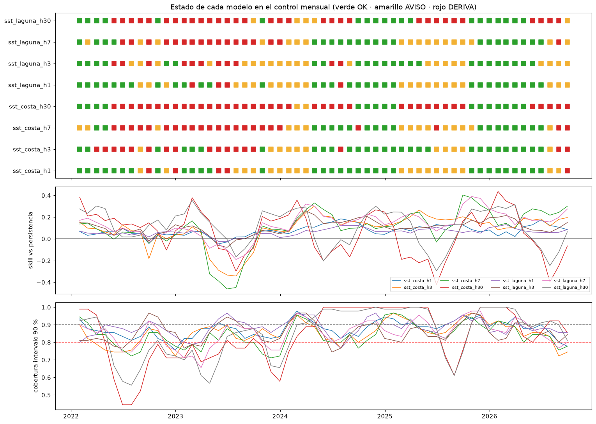

# Fase 7 · Bloque 2 — Monitor de deriva y reentrenamiento

*2026-11-10 · v0.8.0*

## Para qué
Un modelo aprende las relaciones de su periodo de entrenamiento (aquí 1998–2021). Si el mar cambia, sigue prediciendo con aplomo pero peor. El monitor responde a una pregunta: **¿sigue siendo válido el modelo para el mar de hoy?** Cuando la respuesta es no, el reentrenamiento lo corrige, pero solo si de verdad mejora.

```
datos ──► monitorizar.py ──► reentrenar.py (campeón vs retador) ──► registro (@produccion / @anterior) ──► exportar ──► API
              │                                                                                                   │
              └──────────────────────── GET /monitor · pestaña Modelos del dashboard ◄────────────────────────────┘
```

Todo en un comando: `python scripts/ciclo_mantenimiento.py`. Se puede programar con el Programador de tareas de Windows; las instrucciones están en el propio script.

**Por qué no Airflow:** una sola máquina, 8 GB de RAM y un flujo lineal de 3–4 pasos. Airflow (servidor, planificador, base de datos, varios contenedores) costaría más de lo que aporta.

## Qué vigila (`gemelo.monitor`)
| Señal | Cómo | Estado |
|---|---|---|
| **Entradas** | PSI de las 10 variables más importantes de cada modelo frente al entrenamiento **en la misma época del año** (±15 días), más la fracción de días fuera del rango visto | AVISO |
| **Rendimiento** | En los últimos 90 días con verdad conocida y **fuera de muestra**: skill frente a la persistencia y cobertura real del intervalo **tal y como lo sirve la API** | DERIVA |
| **Previsión** | Cambio del sesgo de la previsión (ya corregido) frente a ERA5 | AVISO |
| **Hipoxia** | Días desde la última campaña in situ | SIN_DATOS si > 30 |

- **DERIVA** = ha empeorado el rendimiento: hay que actuar.
- **AVISO** = han cambiado las entradas aunque el rendimiento aguante.

Los dos estados disparan el reentrenamiento, y la regla de promoción protege contra cambios a peor.

## Tres problemas que el propio monitor destapó
1. **El umbral de manual del PSI (0,25) no sirve.**
   - El primer histórico daba AVISO en *todos* los meses de 2022–2026.
   - Calibrado con años normales (2010–2018, dejando fuera el año de cada ventana), el PSI mensual ya llega a **4–7** (p95).
   - El motivo es que las anomalías persisten semanas, así que ninguna ventana de 90 días es "típica".
   - Ahora el umbral es por modelo (`data/processed/monitor_calibracion.json`). Los contadores (`dias_desde_*`, `racha_*`) se excluyen del PSI porque crecen de 1 en 1.
2. **El intervalo estaba mal calibrado por estación, no por deriva.**
   - La cobertura caía **todos los veranos** (hasta el 40–75 %) y rozaba el 100 % en invierno: mezclaba los errores de verano (grandes) con los de invierno.
   - Nuevo intervalo **conformal en cascada**: misma época de los últimos 3 años → últimos 365 días → cuantiles de validación. Es la misma función para la API y el monitor.

   | Media de los 8 modelos, test 2023–2026 | Invierno | Primavera | Verano | Otoño | Global |
   |---|---|---|---|---|---|
   | Cobertura móvil 365 d → estacional | 94 → 89 % | 89 → 87 % | **83 → 85 %** | 90 → 88 % | 88,9 → 87,0 % |
   | Ancho medio (°C) | 2,31 → **1,69** | 2,29 → 1,96 | 2,28 → 2,25 | 2,32 → 2,32 | |
   | Interval score (menor = mejor) | 2,73 → **2,38** | 3,19 → **2,77** | 3,67 → **3,39** | 4,69 → **4,62** | 3,50 → **3,21** |

   - El estacional gana en el **91 %** de las combinaciones modelo × estación.
   - Coste: la cobertura global queda en el 87 %, algo por debajo del 90 % nominal (limitación conocida).
3. **El modelo a 30 días había dejado de servir.** No batía a la persistencia en los veranos de 2023–2026 (hasta −40 %). Es deriva de rendimiento real.



Histórico mensual (8 modelos × mes):

| Año | OK | AVISO | DERIVA | Lectura |
|---|---|---|---|---|
| 2022 | 41 | 15 | 40 | |
| 2023 | 14 | 20 | **62** | Modelos sin previsión, verano fuera de rango |
| 2024 | **56** | 24 | 16 | Entran los modelos con previsión (feb-2024) |
| 2025 | 39 | 42 | 15 | Verano récord: entradas fuera de rango |
| 2026 | 43 | 14 | 15 | |

## Reentrenamiento: campeón vs. retador (`scripts/reentrenar.py`)
1. El **retador** tiene el mismo tipo de modelo y los mismos hiperparámetros que el campeón. Se entrena con todo lo anterior a la ventana de evaluación (los últimos 180 días con verdad conocida), con purga de frontera.
2. Los dos se evalúan en esa ventana con las variables **de servicio** (previsión real).
3. El retador solo se promociona si mejora **≥ 2 %**. Si lo hace, se **reajusta con todos los datos** y ese es el que se despliega. El campeón queda como `@anterior`, para poder volver atrás.

Resultado del ciclo del 30-09-2026 (lo disparó el monitor):

| Modelo | Campeón | Retador | Persistencia | Mejora | Decisión |
|---|---|---|---|---|---|
| laguna h30 | 1,524 (v1) | **1,305** | 1,506 | **+14,4 %** | → v2 |
| costa h30 | 1,411 (v1) | **1,218** | 1,297 | **+13,7 %** | → v2 |
| costa h3 | 0,610 | 0,562 | 0,753 | +8,0 % | → v3 |
| laguna h3 | 0,876 | 0,818 | 0,983 | +6,6 % | → v3 |
| laguna h1 | 0,533 | 0,512 | 0,572 | +3,8 % | → v3 |
| costa h1 | 0,409 | 0,395 | 0,462 | +3,3 % | → v3 |
| costa h7 | 0,716 | 0,700 | 0,995 | +2,3 % | → v3 |
| laguna h7 | 0,997 | 0,977 | 1,278 | +1,99 % | se mantiene v2 |

- **Los modelos a 30 días vuelven a batir a la persistencia.** Los campeones perdían contra ella en 2026, que es justo lo que había detectado el monitor.
- Tras el reentrenamiento, la fracción de días fuera de rango baja de 26–68 % a **0–1 %**: los modelos ya han visto el mar de 2022–2026. Esto alivia la saturación de los árboles que vimos en los escenarios (aire +3/+6 °C con el mismo efecto).

## Salvaguardas de honestidad (todas con test)
- **`datos_hasta` por modelo** (etiqueta en el registro, exportada al servicio):
  - La API marca `visto_en_entrenamiento` según el modelo concreto.
  - El monitor solo mide el rendimiento en días **fuera de muestra**. Los recién reentrenados muestran "aún no evaluable" en lugar de un acierto ficticio.
  - La referencia de entradas y el rango de los escenarios también son los de cada modelo.
- **El intervalo solo usa errores fuera de muestra.** Si usara los días que el modelo ya vio, se estrecharía artificialmente justo después de cada reentrenamiento. Mientras no haya datos nuevos, usa los cuantiles medidos en la ventana de evaluación del retador.
- **Sin bucles:**
  - El monitor no propone reentrenar un modelo reentrenado hace menos de 90 días (`en_espera_tras_reentreno`).
  - `reentrenar.py` se niega a comparar si el campeón ya vio la ventana de evaluación.

## Limitaciones
- La decisión se toma con **una sola ventana de 180 días** (sobre todo primavera y verano). Las mejoras del 2–4 % de los modelos de 1 día podrían ser ruido; las del 7–14 % son claras.
- El modelo desplegado (reajustado con todo) no es exactamente el evaluado. Es la práctica habitual, pero su rendimiento real solo se conocerá cuando lleguen datos nuevos.
- Los respaldos sin previsión (v1) no se reentrenan.
- La hipoxia **no se puede vigilar**: no hay datos in situ desde julio de 2024.
- El monitor detecta un **cambio del sesgo del viento previsto** (−2,3 km/h a 7 días en la cuenca, frente a ±2 de umbral). Conviene recalibrar la corrección de sesgo de la previsión con datos recientes; queda como siguiente paso.
- La descarga de datos nuevos (ampliar `periodo.fin`) sigue siendo manual. Para tiempo real harían falta los productos NRT de Copernicus, sin verificar.
